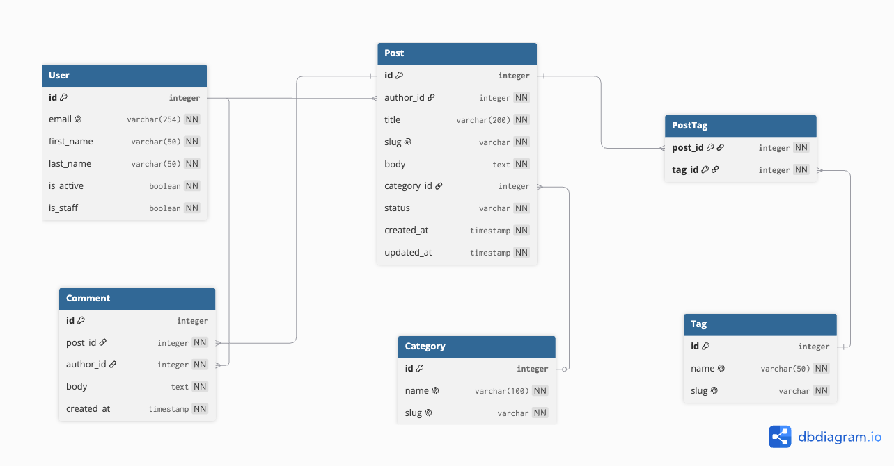
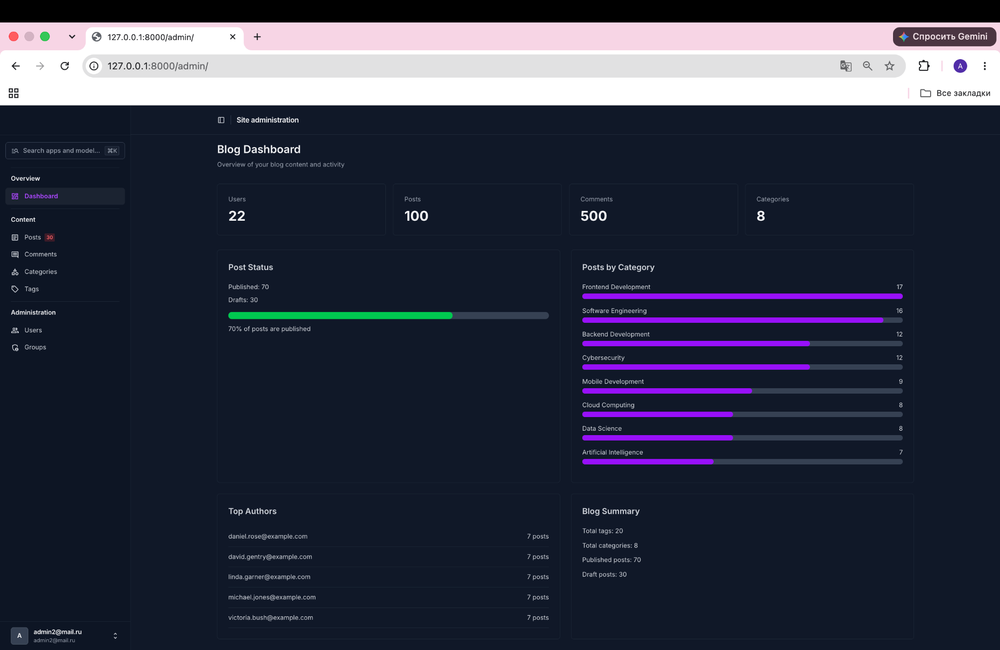
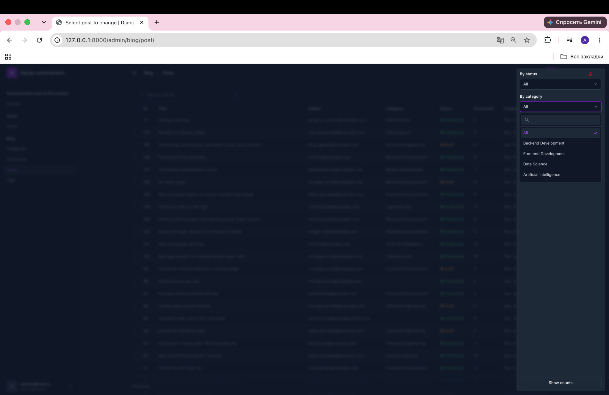
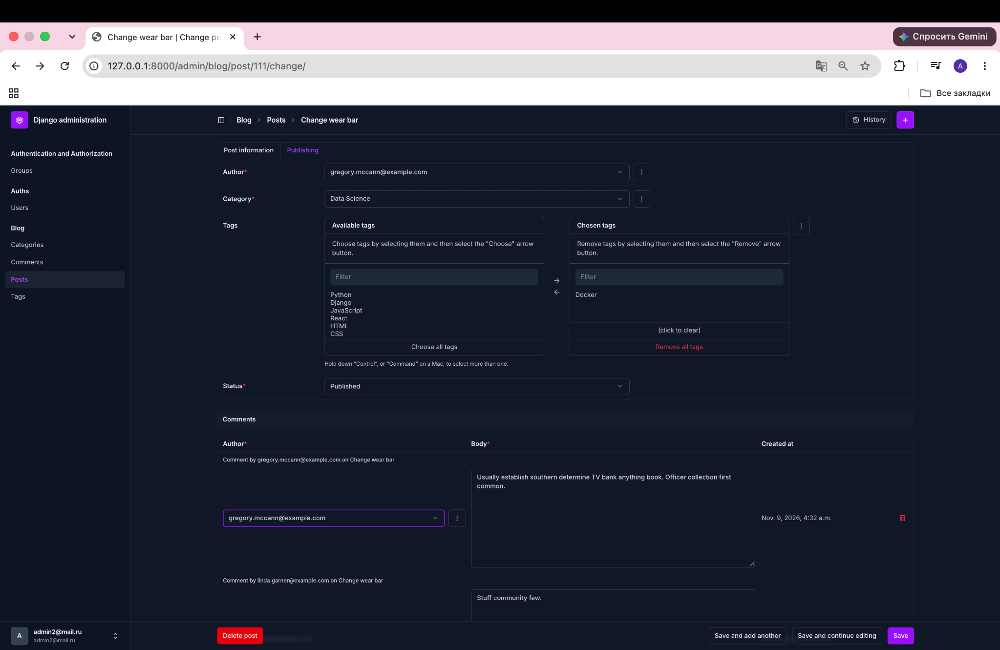
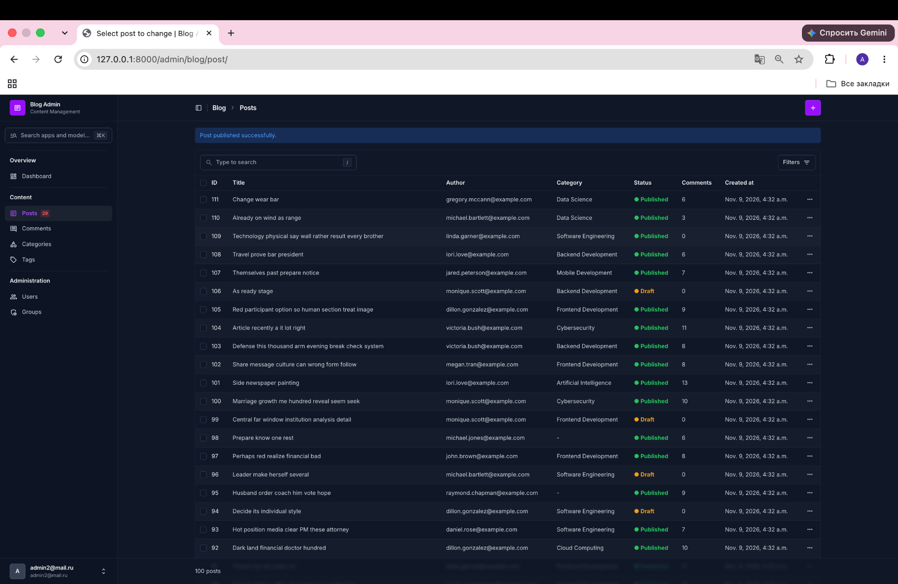
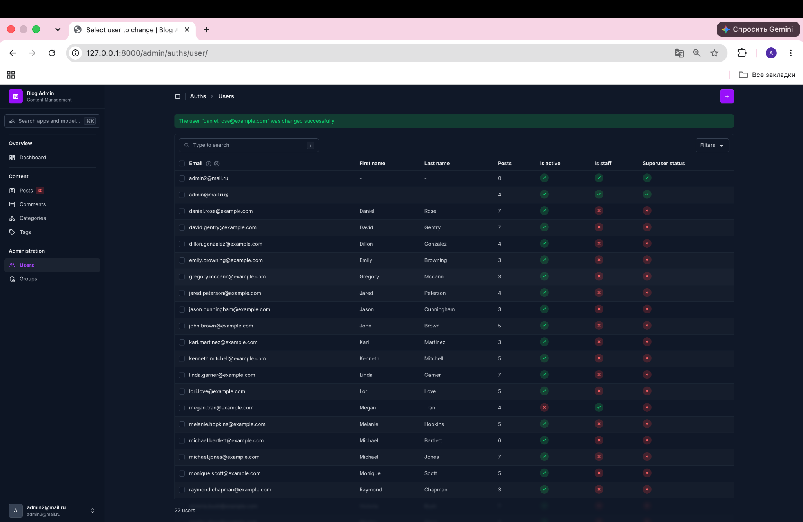

# Blog API

REST API for a blog application built with Django and Django REST Framework.

## Project Overview

The project provides a blog management system with a custom user model, posts, categories, tags, and comments.

Homework 2 adds a database seed command and a customized Django Unfold administration interface.

## Technologies

- Python 3.13
- Django 6.1
- Django REST Framework
- Django Unfold
- Faker
- SQLite for local development
- PostgreSQL for production

## Entity-Relationship Diagram



## Installation

1. Clone the repository:

   ```bash
   git clone https://github.com/Adishkaboii/blog-api.git
   cd blog-api
   ```

2. Create and activate a virtual environment:

   ```bash
   python3 -m venv .venv
   source .venv/bin/activate
   ```

3. Install dependencies:

   ```bash
   pip install -r requirements/dev.txt
   ```

4. Configure the required environment variables.

Create a file named `.env` inside the `settings/` directory.

For local development, use the following example:

```env
BLOG_SECRET_KEY=replace-with-your-own-secret-key
BLOG_DEBUG=True
BLOG_ALLOWED_HOSTS=127.0.0.1,localhost

BLOG_DB_NAME=blog
BLOG_DB_USER=postgres
BLOG_DB_PASSWORD=
BLOG_DB_HOST=localhost
BLOG_DB_PORT=5432
```

Generate a secure Django secret key instead of using the placeholder.

The local development configuration uses SQLite if configured in `settings/env/local.py`. PostgreSQL connection variables are available for environments that use PostgreSQL.

**Security:** Do not commit the actual `settings/.env` file to GitHub.

5. Apply migrations:

   ```bash
   python manage.py migrate
   ```

6. Create a superuser:

   ```bash
   python manage.py createsuperuser
   ```

7. Start the development server:

   ```bash
   python manage.py runserver
   ```

Open the admin panel at:

http://127.0.0.1:8000/admin/

## Database Seed Command

The project includes a custom Django management command that generates sample blog data using Faker.

Run the command with default values:

```bash
python manage.py seed
```

By default, it creates:

- 20 users
- 100 posts
- 500 comments
- 8 categories
- 20 tags

### Custom Counts

You can specify the number of users, posts, and comments:

```bash
python manage.py seed --users 10 --posts 50 --comments 200
```

### Clear Existing Data

To delete existing blog data and generate new sample records:

```bash
python manage.py seed --clear
```

**Warning:** The `--clear` option deletes existing posts, comments, categories, tags, and all non-superuser accounts. Superusers are preserved.

Use this option only in a development or test database.

### Seed Features

- Unique user emails and post slugs
- Passwords stored as hashes
- Approximately 70% published posts and 30% drafts
- Optional post categories
- Up to five tags per post
- Comments attached only to published posts during generation
- Bulk creation for users, posts, and comments
- Validation of negative arguments
- Atomic database transaction
- Execution time and creation summary

Categories and tags are reused when the command runs again without `--clear`.

## Django Unfold Admin

The administration interface uses Django Unfold.

### Dashboard

The dashboard displays:

- Total users, posts, comments, and categories
- Published and draft post statistics
- Posts by category
- Top five authors by post count
- Sidebar navigation with a draft post counter

### Posts

- Colored publication statuses
- Comment counts
- Search and advanced filters
- Bulk publish and draft actions
- Row actions for individual posts
- Tabbed editing form
- Inline comment management

### Users

- Search by email and name
- Active, staff, and superuser filters
- Post counts
- Bulk activation and deactivation
- Permission management
- Tabbed editing form

### Categories and Tags

- Automatic slug suggestions
- Search by name
- Post counts with sorting

### Comments

- Search by text, author, or post
- Filters by date and post
- Autocomplete for related objects
- Short comment previews

## Admin Screenshots

### Dashboard



### Posts and Filters



### Post Editing



### Post Publishing



### Users



## Development Checks

Run the following commands to check the project:

```bash
ruff check .
python manage.py check
python manage.py makemigrations --check --dry-run
```
